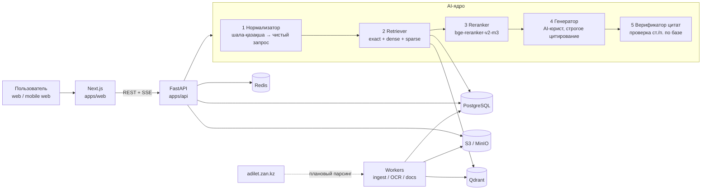

# 01. Архитектура «Портал ЖКХ 24: AI-юрист по закону и НПА»

> Статус: проект архитектуры (Шаг 1). Код начинаем писать после подтверждения.

## 1. Ключевые архитектурные решения

| Вопрос | Решение | Почему |
|---|---|---|
| Frontend | **Next.js 15 (App Router) + TypeScript + Tailwind CSS + shadcn/ui**, `next-intl` (kk/ru), `next-themes` | SSR для SEO справочника НПА, стриминг ответов чата, готовые доступные компоненты |
| Backend | **Python 3.12 + FastAPI** (async), SQLAlchemy 2 + Alembic, Pydantic v2 | Вся NLP/RAG-экосистема (эмбеддинги, реранкеры, парсинг, docx) — на Python; один язык для API и пайплайна |
| Фоновые задачи | **Celery/Arq + Redis** | Парсинг Adilet, индексация, OCR договоров, генерация PDF |
| LLM | **Claude API, модель `claude-opus-5-5`** через официальный SDK `anthropic`; adaptive thinking, стриминг, structured outputs | Сильное рассуждение по праву, 1M контекст, хорошее понимание казахского/русского. Имя модели — в конфиге |
| Эмбеддинги | **BAAI/bge-m3** (self-hosted, 1024-dim, dense + sparse) | Мультиязычная модель с поддержкой казахского; даёт и dense, и lexical (sparse) веса |
| Reranker | **BAAI/bge-reranker-v2-m3** (self-hosted) | Мультиязычный cross-encoder |
| Vector DB | **Qdrant** (dense + sparse named vectors, payload-фильтры) | Нативный гибридный поиск, фильтры по НПА/редакции/языку |
| Основная БД | **PostgreSQL 16** — источник истины (НПА, редакции, пользователи, чаты, документы) | Qdrant — только индекс; всегда можно переиндексировать из Postgres |
| Файлы | **S3-совместимое хранилище (MinIO локально)** | Загруженные договоры, сгенерированные .docx/.pdf |
| Документы | `docxtpl` (Jinja-шаблоны .docx) → `LibreOffice headless` → PDF | Юристы правят шаблоны в Word, без программиста |
| Разбор файлов | `pypdf`/`pdfplumber`, `python-docx`, OCR `tesseract (kaz+rus)` для сканов | Сканы протоколов ОСИ — частый случай |
| Наблюдаемость | Sentry, OpenTelemetry, Langfuse-подобный лог RAG-трасс (self-hosted) | Разбор каждого «неправильного» ответа юриста до чанка |
| Инфраструктура | Docker Compose (dev) → Kubernetes/VPS в Казахстане (prod) | Персональные данные граждан РК — хранение на территории РК (Закон РК «О персональных данных и их защите») |

## 2. Общая схема



## 3. Модули сервиса

| # | Модуль | Backend-сервис | Что делает |
|---|---|---|---|
| 1 | **Case Analyzer** | `services/case_analyzer` | Нормализация → поиск → анализ: суть, роли сторон, нормы, кто отвечает, перспективы/риски |
| 2 | **Action Plan** | часть ответа анализатора + `services/action_plan` | Чек-лист шагов с органами (ОСИ, жилинспекция, eOtinish, ДЧС, СЭС, суд), доказательствами и сроками |
| 3 | **Document Builder** | `services/documents` | Сбор полей из диалога (LLM-extraction в JSON-схему шаблона) → дозапрос недостающих полей → .docx/.pdf |
| 4 | **Калькуляторы** | `services/calculators` (чистый Python, без LLM) | Пеня; кворум/голоса собрания. LLM только объясняет результат |
| 5 | **Document Review** | `services/review` | Загрузка PDF/DOCX → разбор на пункты → проверка каждого пункта по RAG → список нарушений с нормами |
| 6 | **Справочник НПА + шаблоны** | `services/library` | Дерево НПА → статья → пункт, история редакций, умный поиск (тот же гибридный retriever) |

## 4. RAG-пайплайн (детально)

### 4.1 Ингест законов (offline)

```
adilet.zan.kz  ──►  fetcher (кэш HTML, уважение robots/rate-limit)
              ──►  parser: HTML → дерево [Акт → Раздел → Глава → Статья → Пункт → Подпункт]
              ──►  version detector: дата редакции, «изменено Законом от …», утратившие силу нормы
              ──►  PostgreSQL (legal_acts / act_versions / legal_units)
              ──►  chunker (единица = пункт статьи; короткие статьи — целиком)
              ──►  bge-m3 (dense + sparse)  ──►  Qdrant (collection `legal_chunks`)
```

Правила чанкинга:
- **Граница чанка = юридическая единица** (статья / пункт / подпункт), никогда не режем посередине пункта.
- В текст чанка добавляется «шапка контекста»: `Закон РК «О жилищных отношениях» › Глава 4 › Статья 42 › п. 3` — так эмбеддинг знает, откуда кусок.
- Каждый чанк хранится на **kk и ru** (Adilet публикует обе версии) с общим `unit_id` — ответ можно цитировать на языке пользователя.
- Утратившие силу редакции не удаляются: `is_current=false`, используются только при вопросах «как было на дату X» (спор о событии в прошлом).
- Ежесуточный diff-краулер: изменилась редакция → новая `act_version`, переиндексация только изменённых единиц, уведомление в админке.

### 4.2 Онлайн-запрос

1. **Нормализация (LLM, structured output).** Вход — сырой текст (шала-қазақша, латиница, ошибки). Выход JSON: язык, чистая формулировка на ru и kk, роли сторон, тип проблемы, упомянутые статьи, 3–5 поисковых подзапросов, нужны ли уточнения. Промпт — в `02-system-prompt.md`.
2. **Retrieval, три канала параллельно:**
   - *Exact resolver* — regex + словарь сокращений (`ст 42 ЗЖО`, `КоАП 4xx`, `жил. закон`) → прямой SQL по `legal_units`. Номер статьи никогда не ищем «семантически».
   - *Dense* — bge-m3 по подзапросам, фильтр `is_current=true`, `lang in (kk, ru)`.
   - *Sparse/BM25-подобный* — sparse-вектор bge-m3 в Qdrant (термины: «ОСИ», «капремонт», «акт обследования»).
   - Слияние **RRF**, top-40.
3. **Rerank** cross-encoder → top-8…12 чанков; плюс «соседи» (предыдущий/следующий пункт той же статьи) для полноты.
4. **Генерация** — системный промпт AI-юриста + `<context>` с чанками, у каждого `chunk_id`, акт, статья, пункт, редакция, ссылка Adilet. Ответ в строгой JSON-схеме (structured outputs) → фронт рендерит карточки.
5. **Верификатор цитат (детерминированный).** Каждая ссылка в ответе (`chunk_id` + номер статьи) сверяется с выданным контекстом и БД. Ссылка не найдена → удаляется, ответ помечается `needs_review`, в лог. Это главный барьер против галлюцинаций.
6. **Логирование трассы**: запрос → нормализация → найденные чанки → ответ → оценка пользователя (👍/👎) — база для eval-набора.

### 4.3 Принципы против галлюцинаций
- Модель **не может** сослаться на статью, которой нет в `<context>` (промпт + верификатор).
- Нет релевантных норм → ответ «в базе не найдено» + что уточнить / к кому обратиться.
- Каждый ответ показывает **дату редакции** нормы и ссылку на Adilet.
- Дисклеймер: сервис не заменяет адвоката в суде; для сложных случаев — кнопка «Передать юристу» (будущий B2B-модуль).

## 5. Схема базы данных PostgreSQL

```sql
-- ========== Пользователи и доступ ==========
CREATE TYPE user_role AS ENUM ('citizen', 'osi_chair', 'management_co', 'developer', 'lawyer', 'admin');
CREATE TYPE ui_lang   AS ENUM ('kk', 'ru');

CREATE TABLE users (
  id              uuid PRIMARY KEY DEFAULT gen_random_uuid(),
  email           citext UNIQUE,
  phone           text UNIQUE,
  password_hash   text,
  full_name       text,
  role            user_role NOT NULL DEFAULT 'citizen',
  preferred_lang  ui_lang   NOT NULL DEFAULT 'ru',
  city            text,                       -- для подбора местного акимата/инспекции
  created_at      timestamptz NOT NULL DEFAULT now(),
  deleted_at      timestamptz
);

-- Объект кондоминиума (дом) — нужен председателям ОСИ и для калькулятора кворума
CREATE TABLE buildings (
  id              uuid PRIMARY KEY DEFAULT gen_random_uuid(),
  owner_user_id   uuid REFERENCES users(id),
  address         text NOT NULL,
  city            text NOT NULL,
  management_form text CHECK (management_form IN ('OSI','PT','direct','KSK_legacy')),
  osi_bin         text,
  created_at      timestamptz NOT NULL DEFAULT now()
);

CREATE TABLE premises (                        -- квартиры и нежилые помещения
  id              uuid PRIMARY KEY DEFAULT gen_random_uuid(),
  building_id     uuid NOT NULL REFERENCES buildings(id) ON DELETE CASCADE,
  number          text NOT NULL,
  kind            text NOT NULL CHECK (kind IN ('apartment','non_residential','parking')),
  area_m2         numeric(10,2),
  owner_name      text,
  UNIQUE (building_id, number)
);

-- ========== Законодательство (источник истины для RAG) ==========
CREATE TABLE legal_acts (
  id              uuid PRIMARY KEY DEFAULT gen_random_uuid(),
  code            text UNIQUE NOT NULL,       -- 'ZHO', 'KOAP', 'GK_GEN', 'GK_SPEC', 'ZPP', 'PK', 'ZEM', 'GPK', 'APPK', 'SANPIN_...'
  act_type        text NOT NULL,              -- law, code, gov_decree, ministry_order, sanpin, snip, template
  title_ru        text NOT NULL,
  title_kk        text,
  number          text,                       -- '94-I'
  adopted_at      date,
  adilet_id       text,                       -- идентификатор документа на Adilet
  adilet_url_ru   text,
  adilet_url_kk   text,
  hierarchy_level smallint NOT NULL,          -- 1 Конституция, 2 Кодекс, 3 Закон, 4 Постановление Правительства, 5 Приказ министра…
  status          text NOT NULL DEFAULT 'active' CHECK (status IN ('active','repealed'))
);

CREATE TABLE act_versions (                   -- редакции
  id              uuid PRIMARY KEY DEFAULT gen_random_uuid(),
  act_id          uuid NOT NULL REFERENCES legal_acts(id),
  valid_from      date NOT NULL,
  valid_to        date,                       -- NULL = действует
  source_hash     text NOT NULL,              -- sha256 исходного HTML для diff
  fetched_at      timestamptz NOT NULL DEFAULT now(),
  is_current      boolean NOT NULL DEFAULT false
);
CREATE UNIQUE INDEX one_current_version ON act_versions(act_id) WHERE is_current;

CREATE TABLE legal_units (                    -- дерево: раздел → глава → статья → пункт → подпункт
  id              uuid PRIMARY KEY DEFAULT gen_random_uuid(),
  version_id      uuid NOT NULL REFERENCES act_versions(id) ON DELETE CASCADE,
  parent_id       uuid REFERENCES legal_units(id),
  unit_type       text NOT NULL CHECK (unit_type IN ('section','chapter','article','point','subpoint','part','annex')),
  number          text,                       -- '42', '42-1', '3', '1)'
  path            text NOT NULL,              -- 'ch4/art42/p3' — стабильный адрес
  heading_ru      text,
  heading_kk      text,
  text_ru         text,
  text_kk         text,
  notes_ru        text,                       -- сноски Adilet: «в редакции Закона РК от …»
  notes_kk        text,
  adilet_anchor   text,                       -- 'z1898' → ссылка adilet…/Z970000094_#z1898
  is_repealed     boolean NOT NULL DEFAULT false,
  ord             int NOT NULL,
  tsv_ru          tsvector GENERATED ALWAYS AS (to_tsvector('russian', coalesce(heading_ru,'')||' '||coalesce(text_ru,''))) STORED
);
CREATE INDEX legal_units_path ON legal_units(version_id, path);
CREATE INDEX legal_units_tsv  ON legal_units USING gin(tsv_ru);

CREATE TABLE legal_chunks (                   -- то, что лежит в Qdrant (point id = chunks.id)
  id              uuid PRIMARY KEY DEFAULT gen_random_uuid(),
  unit_id         uuid NOT NULL REFERENCES legal_units(id) ON DELETE CASCADE,
  lang            ui_lang NOT NULL,
  breadcrumb      text NOT NULL,              -- 'Закон РК «О жилищных отношениях» › Ст. 42 › п. 3'
  content         text NOT NULL,
  token_count     int,
  embedded_at     timestamptz,
  UNIQUE (unit_id, lang)
);

CREATE TABLE legal_glossary (                 -- термины kk/ru/сленг → нормальный термин (помогает нормализатору и BM25)
  id              serial PRIMARY KEY,
  term_norm_ru    text NOT NULL,              -- 'объединение собственников имущества'
  term_norm_kk    text,                       -- 'мүлік иелерінің бірлестігі'
  variants        text[] NOT NULL             -- {'оси','osi','осы','мүлік иелері','кск','кэскэ'}
);

-- ========== Чаты и анализ дел ==========
CREATE TABLE cases (                          -- «дело» = тема пользователя (затопление, ОСИ, тариф…)
  id              uuid PRIMARY KEY DEFAULT gen_random_uuid(),
  user_id         uuid NOT NULL REFERENCES users(id),
  building_id     uuid REFERENCES buildings(id),
  title           text,
  category        text,                       -- flooding, osi_governance, tariffs, noise, redevelopment, repair, developer_defects…
  status          text NOT NULL DEFAULT 'open',
  created_at      timestamptz NOT NULL DEFAULT now()
);

CREATE TABLE messages (
  id              uuid PRIMARY KEY DEFAULT gen_random_uuid(),
  case_id         uuid NOT NULL REFERENCES cases(id) ON DELETE CASCADE,
  role            text NOT NULL CHECK (role IN ('user','assistant','system_note')),
  content_raw     text,                       -- как написал пользователь
  normalized      jsonb,                      -- выход нормализатора
  answer          jsonb,                      -- структурированный ответ AI (см. схему в 02)
  lang            ui_lang,
  model           text,
  usage           jsonb,                      -- токены/стоимость
  needs_review    boolean NOT NULL DEFAULT false,
  created_at      timestamptz NOT NULL DEFAULT now()
);

CREATE TABLE message_citations (              -- какие нормы реально процитированы
  message_id      uuid REFERENCES messages(id) ON DELETE CASCADE,
  chunk_id        uuid REFERENCES legal_chunks(id),
  unit_id         uuid REFERENCES legal_units(id),
  verified        boolean NOT NULL,           -- прошла ли детерминированную проверку
  PRIMARY KEY (message_id, chunk_id)
);

CREATE TABLE retrieval_traces (               -- для отладки и eval
  id              uuid PRIMARY KEY DEFAULT gen_random_uuid(),
  message_id      uuid REFERENCES messages(id) ON DELETE CASCADE,
  queries         jsonb,
  candidates      jsonb,                      -- [{chunk_id, dense, sparse, rrf, rerank}]
  latency_ms      jsonb
);

CREATE TABLE feedback (
  message_id      uuid PRIMARY KEY REFERENCES messages(id) ON DELETE CASCADE,
  rating          smallint CHECK (rating IN (-1, 1)),
  comment         text,
  lawyer_verdict  text                        -- разметка юристом: correct / wrong_norm / outdated / incomplete
);

-- ========== Документы ==========
CREATE TABLE doc_templates (
  id              uuid PRIMARY KEY DEFAULT gen_random_uuid(),
  code            text UNIQUE NOT NULL,       -- 'claim_osi', 'complaint_housing_inspection', 'flood_act', 'osi_protocol', 'ballot', 'lawsuit_damage', 'lawsuit_protocol_invalid'
  lang            ui_lang NOT NULL,
  title           text NOT NULL,
  file_key        text NOT NULL,              -- .docx шаблон в S3
  fields_schema   jsonb NOT NULL,             -- JSON Schema полей (для LLM-извлечения и формы)
  legal_basis     uuid[],                     -- legal_units, на которые ссылается шаблон
  version         int NOT NULL DEFAULT 1,
  is_active       boolean NOT NULL DEFAULT true
);

CREATE TABLE generated_documents (
  id              uuid PRIMARY KEY DEFAULT gen_random_uuid(),
  user_id         uuid NOT NULL REFERENCES users(id),
  case_id         uuid REFERENCES cases(id),
  template_id     uuid NOT NULL REFERENCES doc_templates(id),
  data            jsonb NOT NULL,             -- заполненные поля
  docx_key        text,
  pdf_key         text,
  created_at      timestamptz NOT NULL DEFAULT now()
);

-- ========== Анализ договоров / смет / протоколов ==========
CREATE TABLE uploaded_files (
  id              uuid PRIMARY KEY DEFAULT gen_random_uuid(),
  user_id         uuid NOT NULL REFERENCES users(id),
  case_id         uuid REFERENCES cases(id),
  file_key        text NOT NULL,
  mime            text NOT NULL,
  kind            text CHECK (kind IN ('contract','estimate','protocol','act','other')),
  extracted_text  text,
  ocr_used        boolean DEFAULT false,
  created_at      timestamptz NOT NULL DEFAULT now()
);

CREATE TABLE reviews (
  id              uuid PRIMARY KEY DEFAULT gen_random_uuid(),
  file_id         uuid NOT NULL REFERENCES uploaded_files(id) ON DELETE CASCADE,
  status          text NOT NULL DEFAULT 'queued',  -- queued / running / done / failed
  summary         jsonb,
  created_at      timestamptz NOT NULL DEFAULT now()
);

CREATE TABLE review_findings (
  id              uuid PRIMARY KEY DEFAULT gen_random_uuid(),
  review_id       uuid NOT NULL REFERENCES reviews(id) ON DELETE CASCADE,
  clause_ref      text,                       -- 'п. 5.2 договора'
  clause_text     text,
  severity        text CHECK (severity IN ('critical','warning','info')),
  issue           text NOT NULL,
  recommendation  text,
  unit_ids        uuid[]                      -- нарушенные нормы
);

-- ========== Калькуляторы и справочные ставки ==========
CREATE TABLE reference_rates (                -- базовая ставка НБ РК, МРП, МЗП — с историей
  id              serial PRIMARY KEY,
  code            text NOT NULL,              -- 'NBRK_BASE_RATE', 'MRP', 'MZP'
  value           numeric(14,4) NOT NULL,
  valid_from      date NOT NULL,
  source_url      text,
  UNIQUE (code, valid_from)
);

CREATE TABLE calculations (
  id              uuid PRIMARY KEY DEFAULT gen_random_uuid(),
  user_id         uuid REFERENCES users(id),
  case_id         uuid REFERENCES cases(id),
  kind            text NOT NULL CHECK (kind IN ('penalty','quorum')),
  input           jsonb NOT NULL,
  result          jsonb NOT NULL,
  created_at      timestamptz NOT NULL DEFAULT now()
);

-- ========== Аудит ==========
CREATE TABLE audit_log (
  id              bigserial PRIMARY KEY,
  user_id         uuid,
  action          text NOT NULL,
  entity          text,
  entity_id       uuid,
  meta            jsonb,
  at              timestamptz NOT NULL DEFAULT now()
);
```

## 6. Схема Qdrant

Коллекция `legal_chunks`:

```json
{
  "vectors":        { "dense":  { "size": 1024, "distance": "Cosine" } },
  "sparse_vectors": { "sparse": {} },   // веса BGE-M3 уже лексические, IDF-модификатор не нужен
  "payload": {
    "chunk_id": "uuid", "unit_id": "uuid", "act_code": "ZHO", "act_type": "law",
    "hierarchy_level": 3, "article": "42", "point": "3", "path": "ch4/art42/p3",
    "lang": "ru", "is_current": true, "valid_from": "2025-01-01", "valid_to": null,
    "topics": ["osi", "general_meeting", "quorum"]
  }
}
```

Индексы payload: `act_code`, `article`, `lang`, `is_current`, `topics`. Отдельная коллекция `user_docs` (временная, на сессию) — для чанков загруженных договоров в Document Review.

## 7. API (основные эндпоинты, v1)

| Метод | Путь | Назначение |
|---|---|---|
| POST | `/auth/register`, `/auth/login`, `/auth/refresh` | JWT (access + refresh в httpOnly cookie) |
| POST | `/cases` / GET `/cases` | Дела пользователя |
| POST | `/cases/{id}/messages` | Вопрос → **SSE-стрим**: `normalized` → `sources` → `answer.delta` → `answer.final` |
| POST | `/documents/draft` | Из дела + кода шаблона → извлечённые поля + список недостающих |
| POST | `/documents` | Сформировать .docx/.pdf → ссылки на скачивание |
| POST | `/calc/penalty`, `/calc/quorum` | Калькуляторы (детерминированные) |
| POST | `/reviews` (multipart) / GET `/reviews/{id}` | Анализ договора/сметы/протокола |
| GET | `/library/acts`, `/library/acts/{code}/units?path=` , `/library/search?q=` | Справочник НПА и поиск |
| GET | `/templates` | База шаблонов |
| — | `/admin/*` | Ингест, статус редакций, разметка ответов юристами |

## 8. Калькуляторы — юридические допущения (требуют проверки юристом при реализации)

- **Пеня.** С 2015 г. Нацбанк РК устанавливает **базовую ставку**, а не «ставку рефинансирования»; в нормах о неустойке за просрочку платежей размер и формула должны браться из конкретной нормы (закон / договор). Калькулятор: `сумма × ставка × дни / 365` либо фиксированный % в день из договора; ставка по датам — из таблицы `reference_rates` с историей; ограничение — исковая давность (общий срок 3 года, ст. 178 ГК РК) с предупреждением.
- **Кворум и голоса собрания ОСИ/ПТ** — сверено с текстом ст. 42 Закона «О жилищных отношениях» на Adilet (редакция гл. 7 Законом РК от 15.07.2025 № 207-VIII), 14.11.2026:
  - **п. 7:** собственник квартиры, нежилого помещения, парковочного места, кладовки имеет **один голос** (несколько помещений — соответствующее число голосов; совместная собственность — один голос). Площадь не учитывается.
  - **п. 8, кворум:** собрание правомочно, если участвуют **более половины** от общего числа собственников квартир, нежилых помещений.
  - **п. 8, решение:** большинство **от участвовавших** в голосовании; по вопросам пп. 6)–16) и 21) п. 5 (смета, взносы, капремонт, сберегательный счёт, лифты, годовой отчёт, общее имущество, аренда, подрядчик капремонта и др.) — большинство **от общего числа** собственников квартир, нежилых помещений.
  - **п. 9:** собственники парковочных мест/кладовок по своим вопросам — большинство от общего числа таких собственников.
  - **п. 11:** решение подъезда о целевых взносах — **более 2/3** собственников квартир, нежилых помещений этого подъезда.
  - Калькулятор считает только по помещениям; пороги хранятся в БД со ссылкой на `legal_units` (пункт статьи), а не захардкожены, и перепроверяются при каждой новой редакции акта.

## 9. Безопасность и соответствие
- ПДн граждан РК — хранение в РК, шифрование at-rest (S3/Postgres), TLS, маскирование ИИН/телефонов в логах и перед отправкой в LLM (PII-scrubber: ИИН, номера карт, телефоны → плейсхолдеры, обратная подстановка при генерации документа локально).
- Rate-limit на AI-эндпоинты, защита от prompt-injection из загружаемых документов (текст договора передаётся как данные в отдельном теге, системный промпт явно запрещает выполнять инструкции из документов).
- Парсинг Adilet: вежливый краулер (кэш, лимит запросов, User-Agent без личных данных), соблюдение условий использования ресурса.
